# 🛡️ Awesome-Cloud-Backup-Disaster-Recovery-BAAS-DRaaS

<div align="center">

<p align="center">
  
</p>

# 🌐 Cloud Backup &amp; Disaster Recovery (BaaS / DRaaS) Ecosystem

**Curated Directory of Cyber-Resilient SaaS Platforms &amp; Battle-Tested Open-Source GitHub Projects**  
*Comprehensive blueprints for Backup as a Service, Disaster Recovery as a Service, Continuous Data Protection &amp; Immutable Ransomware Recovery*

<p align="center">
  <a href="https://github.com/ishandutta2007/Awesome-Awesome-Awesome"></a>
  <a href="https://discord.gg/jc4xtF58Ve"></a>
  <a href="https://github.com/ishandutta2007/Awesome-Cloud-Backup-Disaster-Recovery-BAAS-DRaaS/stargazers"></a>
  <a href="https://github.com/ishandutta2007/Awesome-Cloud-Backup-Disaster-Recovery-BAAS-DRaaS/network/members"></a>
  <a href="https://github.com/ishandutta2007/Awesome-Cloud-Backup-Disaster-Recovery-BAAS-DRaaS/issues"></a>
  <a href="https://github.com/ishandutta2007/Awesome-Cloud-Backup-Disaster-Recovery-BAAS-DRaaS/blob/main/LICENSE"></a>
  <a href="https://github.com/ishandutta2007"></a>
</p>

</div>

---

## 📑 Table of Contents

- [📌 Overview](#-overview)
- [📈 Sector Overview & Market Dynamics](#-sector-overview--market-dynamics)
- [☁️ SaaS / Hosted Platforms](#️-saashosted-platforms)
- [🔓 Open-Source GitHub Projects](#-open-source-github-projects)
- [🏗️ Architectural Reference Stacks](#️-architectural-reference-stacks)
- [🤝 How to Contribute](#-how-to-contribute)
- [💖 Support & Sponsorship](#-support--sponsorship)
- [⭐ Star History](#-star-history)
- [⚠️ Disclaimer](#️-disclaimer)

---

## 📌 Overview

This repository provides an authoritative, SEO-indexed, production-ready directory tracking premier **SaaS platforms** and **open-source software** across **Cloud Backup & Disaster Recovery (BaaS / DRaaS)**. Modern cloud-native infrastructure requires robust resilience engineering: continuous data protection (CDP), immutable object storage, multi-cloud automated failover, clean-room forensic recovery, and rapid recovery time objectives (RTO) and recovery point objectives (RPO) to withstand ransomware disruptions, outages, and regional catastrophe.

Whether you are an enterprise cloud architect designing multi-region failover across AWS, Azure, and Google Cloud, or an SRE engineering self-hosted data pipelines using restic and Velero, this curated guide benchmarks vendor scale, starting price points, free tier/trial boundaries, and open-source capabilities.

---

## 📈 Sector Overview & Market Dynamics

The global **Backup as a Service (BaaS)** market is projected to reach **$11.4B–$14.5B in 2026** (scaling at a >30% CAGR), while the **Disaster Recovery as a Service (DRaaS)** market is estimated at **$16.4B–$23.1B in 2026** (growing at a 16%–23% CAGR), catalyzed by escalating cyberattacks, stricter compliance regulations (such as DORA, NIS2, and HIPAA), and hybrid-cloud adoption. The sector exhibits a **hybrid market concentration**: it is **moderately concentrated at the top** among multi-billion-dollar enterprise platforms (Rubrik, Veeam, Cohesity, Commvault) and hyperscale cloud providers, yet remains **broadly fragmented across mid-market and SMB tiers** where thousands of regional Managed Service Providers (MSPs), specialized BaaS vendors, and self-hosted open-source software address local data sovereignty and custom workloads.

---

## ☁️ SaaS/Hosted Platforms

> [!NOTE]
> All SaaS products are sorted in descending order by company size (valuation / enterprise market capitalization / revenue scale).

| Product | Company Size (Valuation / Revenue) | Pricing (Starting) | Free Tier / Trial Limits | Description |
|---|---|---|---|---|
| 🛡️ **[Rubrik Cloud Data Management](https://www.rubrik.com/)** | **~$25.7B** Market Cap (~$1.54B ARR) | Starts at ~$1.50/user/mo (M365) or ~$50,000–$60,000/yr enterprise commit (Cloud Edition) | 30-day proof-of-concept / evaluation via sales (capped at 10 TB or targeted user quotas; user covers underlying cloud storage/compute) | Cloud data management platform with zero-trust architecture, immutable backups, anomaly detection, and orchestrated ransomware recovery. |
| 🔄 **[Veeam Cloud Connect](https://www.veeam.com/)** | **~$15B** Valuation (~$2B+ ARR) | Starts at $2.63/user/mo (Veeam Data Cloud M365) or $14/TB/mo (Data Cloud Vault storage); VUL perpetual/rental from ~$155/instance/yr | Free forever Community Edition up to 10 workloads (VMs, physical servers, or cloud instances); 30-day trial for enterprise platform | Multi-tenant platform for service providers and hybrid enterprises to deliver Veeam-powered off-site backup, cloud replication, and DRaaS. |
| 🧠 **[Cohesity DataProtect](https://www.cohesity.com/)** | **~$7B–$8B** Valuation (~$1.5B+ pro forma revenue) | DPaaS baseline starts at ~$29,100/yr on AWS Marketplace (10 BETB pack, ~$242/TB/mo) | 30-day free trial for DataProtect as a Service (DPaaS) via assisted partner evaluation | AI-powered data protection with immutable snapshots, threat detection, and DataProtect as a Service (DPaaS) for fully managed cloud backup. |
| 💼 **[Commvault Complete Backup & Recovery](https://www.commvault.com/)** | **~$7.0B** Market Cap (~$1.18B Revenue) | Starts at $1.70/user/mo (Commvault Cloud SaaS for M365) or ~$58.50–$90/TB/mo; $98/VM/yr | 30-day free trial (no credit card required; full access to test hybrid cloud workloads and SaaS apps) | Enterprise data protection with immutable backups, air-gapped cloud copies, and automated cleanroom recovery. |
| 🏢 **[Datto SIRIS](https://www.datto.com/)** | **$6.2B** Acquisition by Kaseya (Parent ARR: ~$1.5B+) | Starting at $995 upfront hardware (or $0 down on commit) + ~$300–$500/mo service fee (1–2 TB baseline) | 14-day free trial for software products (Datto SaaS Protection / RMM); hardware appliance evaluations provided via MSP partner PoC | Business continuity and disaster recovery appliance with local and cloud virtualization, screenshot verification, and ransomware detection. |
| ☁️ **[Druva Backup and Disaster Recovery](https://www.druva.com/)** | **~$2.0B** Valuation (~$200M+ ARR) | Starts at ~$200–$250/TB/month (deduplicated cloud storage) or $4–$8/user/month (inSync endpoint tier) | 30-day free trial (full-featured cloud backup evaluation; no credit card or hardware required) | 100% SaaS cloud-native data protection with agentless backup, global deduplication, and automated multi-cloud DR. |
| 🔐 **[Acronis Cyber Protect Cloud](https://www.acronis.com/)** | **~$1.5B–$3.5B** Valuation (~$420M+ Revenue) | Starts at $1.30–$2.00/seat/mo (M365), $3–$5/workstation/mo, $6.00/VM/mo, or $22.00/server/mo | 30-day free trial for service providers and enterprises (full access to cyber protection suite and cloud backup console) | Cyber protection platform combining backup, disaster recovery, vulnerability management, and AI-based ransomware detection. |
| 💾 **[Carbonite Server](https://www.carbonite.com/)** | **$1.45B** Acquisition by OpenText (Parent Rev: ~$5.8B) | Safe Server Power plan starts at $799.99/year (~$66.66/month billed annually) | 30-day free trial for business/server tiers (up to 500 GB cloud storage, database & bare-metal backup testing) | Server backup with encrypted cloud storage, granular restore, bare-metal recovery, and compliance support (HIPAA/FERPA). |
| ⚡ **[Zerto Disaster Recovery](https://www.zerto.com/)** | **$374M** Acquisition by HPE (~$130M+ Run-Rate Rev) | Enterprise Resilience Edition starts at ~$686–$772 per VM/year (or ~$745–$1,000/VM entry tier) | 14-day software free trial / 30-day cloud marketplace trial (up to 10–15 VMs protected) | Continuous data protection with sub-minute RPOs, journal-based recovery, and orchestrated multi-VM failover. |
| 🌐 **[HYCU R-Cloud (Protégé)](https://www.hycu.com/)** | **~$250M–$500M** Valuation ($140M funding raised) | SaaS app protection starts at ~$1.20–$4.00/user/mo; cloud infrastructure from ~$0.08–$0.10/GiB/mo | 14-day free trial on Azure/AWS Marketplace (30-day for selected SaaS integrations; user covers underlying cloud storage) | Multi-cloud data protection platform protecting 100+ workloads and SaaS applications across AWS, Azure, Google Cloud, and Nutanix. |

---

## 🔓 Open-Source GitHub Projects

> [!TIP]
> All open-source repositories are arranged strictly in **descending order by GitHub Stars_Count**. Each Stars_Badge links directly to the respective repository's stargazers page.

| Project | Stars_Badge | Description | Primary Use Case |
|---|---|---|---|
| 📦 **[Rclone](https://github.com/rclone/rclone)** | [](https://github.com/rclone/rclone/stargazers) | "rsync for cloud storage" command-line utility supporting over 70 cloud object and file storage providers with end-to-end encryption, multi-threaded sync, and bandwidth management. | Cloud data synchronization, offsite backup sync & disaster recovery mirroring |
| 🗄️ **[Restic](https://github.com/restic/restic)** | [](https://github.com/restic/restic/stargazers) | High-performance, secure, deduplicated backup program written in Go. Supports AES-256 encryption, content-defined slicing, and backends including AWS S3, GCS, Azure Blob, SFTP, and MinIO. | Self-hosted BaaS engine, encrypted cloud snapshot archiving |
| 🖥️ **[Duplicati](https://github.com/duplicati/duplicati)** | [](https://github.com/duplicati/duplicati/stargazers) | Open-source backup client featuring an intuitive web-based dashboard, strong GPG/AES-256 encryption, incremental block-level deduplication, and automated integrity validation. | Cross-platform client & server backup to cloud storage targets |
| 🔒 **[Kopia](https://github.com/kopia/kopia)** | [](https://github.com/kopia/kopia/stargazers) | Modern, fast, and secure cross-platform backup engine featuring client-side encryption, deduplication, compression, snapshot retention policies, and both CLI and GUI interfaces. | Cloud-native BaaS repository management, multi-platform desktop & server backups |
| 🛡️ **[BorgBackup](https://github.com/borgbackup/borg)** | [](https://github.com/borgbackup/borg/stargazers) | Battle-tested deduplicating backup tool. Uses authenticated encryption (AES-256 / ChaCha20-Poly1305), chunk-based deduplication, and SSH-based remote storage for space-efficient backups. | Linux server snapshots, off-site repository replication |
| ☸️ **[Velero](https://github.com/vmware-tanzu/velero)** | [](https://github.com/vmware-tanzu/velero/stargazers) | Premier Kubernetes disaster recovery and backup suite. Safely backs up and restores cluster resources and persistent volumes across cloud providers (AWS, Azure, GCP) and on-premises storage. | Kubernetes cluster migration, DR orchestration & persistent volume snapshotting |
| 💾 **[OpenEBS](https://github.com/openebs/openebs)** | [](https://github.com/openebs/openebs/stargazers) | Leading Container Attached Storage (CAS) platform for Kubernetes, providing persistent volume management, cross-cloud asynchronous replication, and snapshot hooks for instant stateful app recovery. | Cloud-native stateful DR, Kubernetes storage replication |
| 🚀 **[Longhorn](https://github.com/longhorn/longhorn)** | [](https://github.com/longhorn/longhorn/stargazers) | Cloud-native distributed block storage system for Kubernetes with built-in disaster recovery volume replication, cross-cluster automated restore, and asynchronous secondary backup to S3/NFS. | Distributed block replication & cross-cluster disaster recovery |
| 🔥 **[LitmusChaos](https://github.com/litmuschaos/litmus)** | [](https://github.com/litmuschaos/litmus/stargazers) | Cloud-native Chaos Engineering framework designed to validate disaster recovery resilience, failover automation, and cloud degradation scenarios through orchestrated chaos experiments. | Chaos resilience testing & DR validation engineering |
| 💽 **[Duplicacy](https://github.com/gilbertchen/duplicacy)** | [](https://github.com/gilbertchen/duplicacy/stargazers) | Innovative lock-free deduplication backup tool that allows multiple clients to back up to the same cloud storage destination simultaneously without synchronization locks. | Multi-client lock-free cloud backup repositories |
| 📼 **[Bareos](https://github.com/bareos/bareos)** | [](https://github.com/bareos/bareos/stargazers) | 100% open-source fork of Bacula providing cross-network backup, recovery, and data verification across heterogeneous data centers, physical servers, VMs, and tape/cloud media. | Multi-tier enterprise data center backup & DR governance |
| 🐧 **[ReaR (Relax-and-Recover)](https://github.com/rear/rear)** | [](https://github.com/rear/rear/stargazers) | Modular bare-metal Linux disaster recovery framework that generates bootable rescue environments and automates full bare-metal restore from network, SAN, or cloud storage. | Bare-metal Linux system disaster recovery & cold-start reconstitution |
| ⚙️ **[K8up](https://github.com/k8up-io/k8up)** | [](https://github.com/k8up-io/k8up/stargazers) | Kubernetes-native backup operator built on top of Restic that automates application snapshots, volume PVC backups, scheduled verification, and cloud offsite pruning via CRDs. | Operator-driven Kubernetes PVC backup automation |
| 🖥️ **[UrBackup](https://github.com/uroni/urbackup_backend)** | [](https://github.com/uroni/urbackup_backend/stargazers) | Client-server open-source network backup system with live image and file backups, fast file deduplication, web-based management, and bare-metal Windows/Linux recovery. | Client-server LAN/WAN backup with bare-metal restore |
| 🧰 **[Kanister](https://github.com/kanisterio/kanister)** | [](https://github.com/kanisterio/kanister/stargazers) | Extensible framework for application-level data management on Kubernetes, providing blueprint-driven backup, restore, point-in-time recovery, and disaster recovery orchestration. | Application-consistent database & stateful Kubernetes DR |
| ☁️ **[cloud-dr-orchestrator](https://github.com/Kobeep/cloud-dr-orchestrator)** | [](https://github.com/Kobeep/cloud-dr-orchestrator/stargazers) | Multi-cloud disaster recovery orchestrator with automated backup scheduling, encryption, and restore workflows targeting Oracle Cloud Free Tier and Grafana observability hooks. | Multi-cloud DR automation & free-tier failover testing |

---

## 🏗️ Architectural Reference Stacks

```
  ┌────────────────────────────────────────────────────────────────────────┐
  │                        PRODUCTION CLOUD RESILIENCE                     │
  └────────────────────────────────────────────────────────────────────────┘
          │                                              │
          ▼                                              ▼
   [ APPLICATION LAYER ]                          [ KUBERNETES / CLOUD ]
   • App Snapshots (Kanister)                     • Cluster Resources & PVCs (Velero)
   • Multi-Client Dedupe (Kopia / Duplicacy)      • Distributed Replicated Storage (Longhorn)
          │                                              │
          └──────────────────────┬───────────────────────┘
                                 │
                                 ▼
                     [ ENGINE & ENCRYPTION LAYER ]
                     • Chunk Deduplication & AES-256 (Restic / Borg)
                     • Multi-Cloud Storage Transport (Rclone)
                                 │
                                 ▼
                     [ OFF-SITE RESILIENT STORAGE ]
                     • Cloud Object Storage (S3 / GCS / Azure Blob / MinIO)
                     • Immutable Object Lock / WORM Policy
                     • Clean-Room Air-Gapped Failover Isolation
```

---

## 🤝 How to Contribute

We welcome community contributions, architectural improvements, and new tool benchmarks! 🚀

1. 🍴 **Fork** this repository.
2. 🌿 Create a new branch: `git checkout -b feature/add-new-tool`
3. 📝 Update `README.md` following our standardized table formatting (include company valuation/revenue or Stars_Badge, starting price points, and factual descriptions).
4. 📬 Submit a concise **Pull Request** with source citations.

---

## 💖 Support & Sponsorship

If this curated backup and disaster recovery directory saved your team time, helped you evaluate enterprise DRaaS tenders, or improved your infrastructure resilience, please consider supporting the project:

- ⭐ **Star this repository** to improve discoverability for fellow DevOps engineers and SREs!
- 🍴 **Fork and share** it with your engineering team or community.
- ☕ **Buy a coffee & sponsor ongoing maintenance:**  
  👉 **[Support on GitHub Sponsors Dashboard](https://github.com/sponsors/ishandutta2007)**

Every contribution helps keep this ecosystem benchmark updated, verified, and free! 🙏

---

## ⭐ Star History

[](https://www.star-history.com/#ishandutta2007/Awesome-Cloud-Backup-Disaster-Recovery-BAAS-DRaaS&type=date&legend=top-left)

---

## ⚠️ Disclaimer

- This directory is a **community-curated benchmark** for architectural and comparative evaluation—not a commercial endorsement.
- Backup, recovery, and DR engines process confidential, business-critical workloads; always mandate **end-to-end encryption (at rest & in transit)**, zero-trust RBAC access controls, immutable object lock policies (WORM), and regular orchestrated restore simulations.
- Always validate recovery point objectives (RPO) and recovery time objectives (RTO) against production SLAs.

---

<div align="center">
  <sub>Maintained with ❤️ by <a href="https://github.com/ishandutta2007">Ishan Dutta</a> and the Cloud Engineering Community.</sub>
</div>
